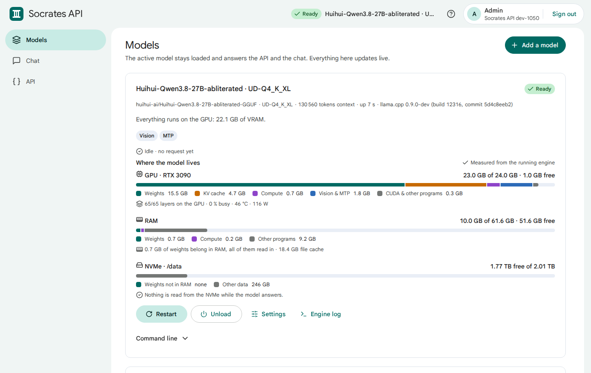
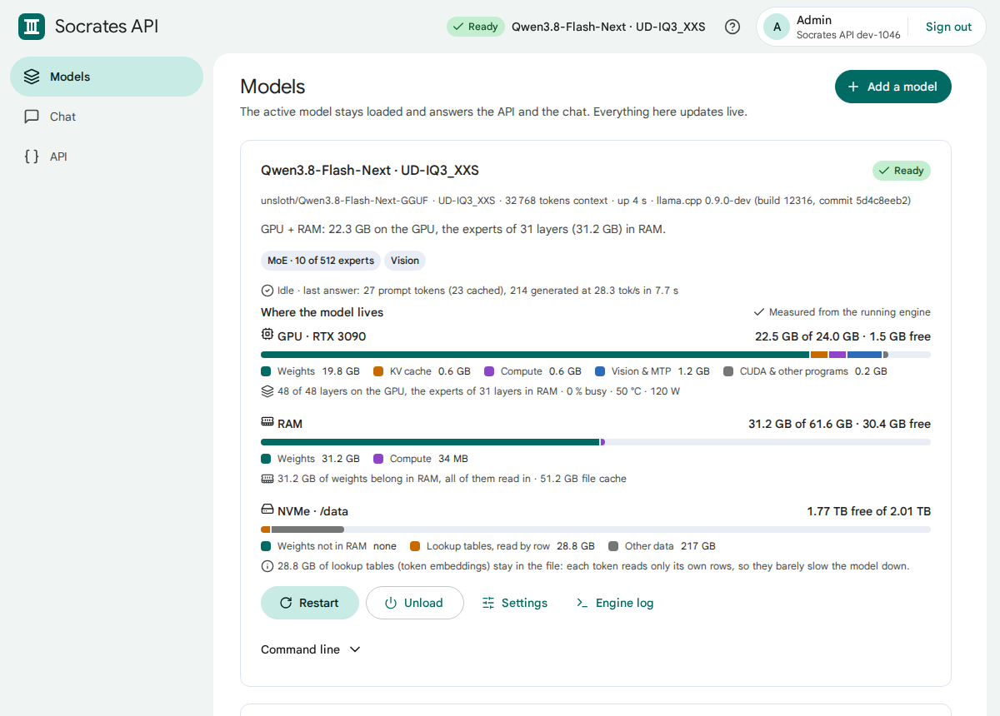
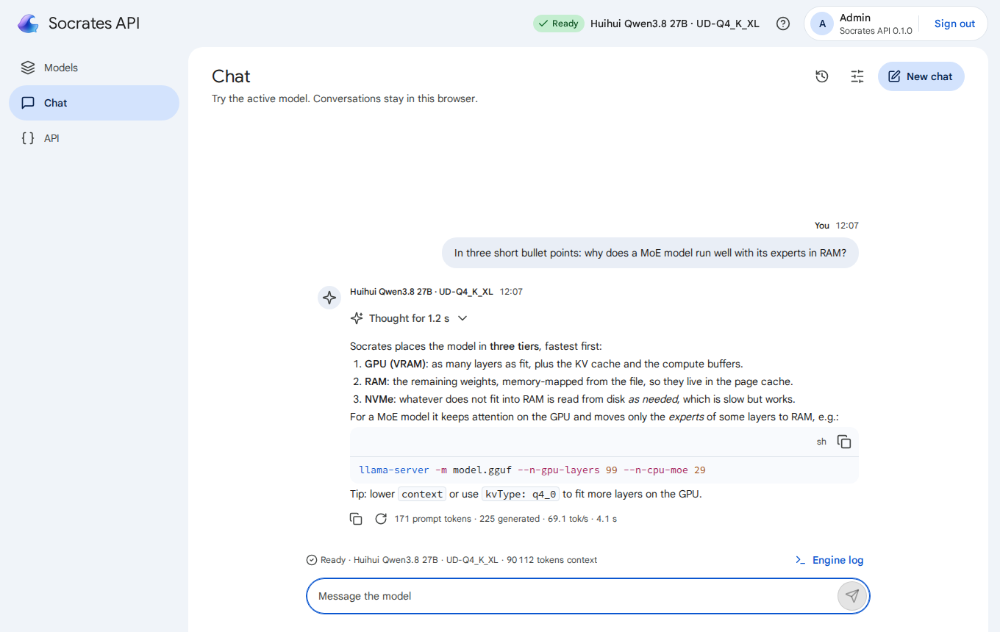
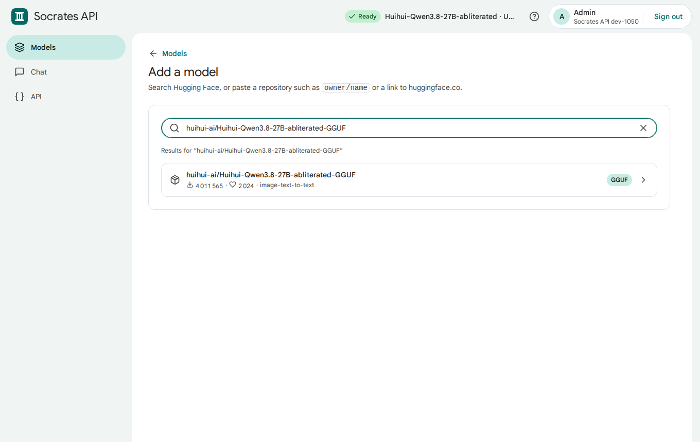
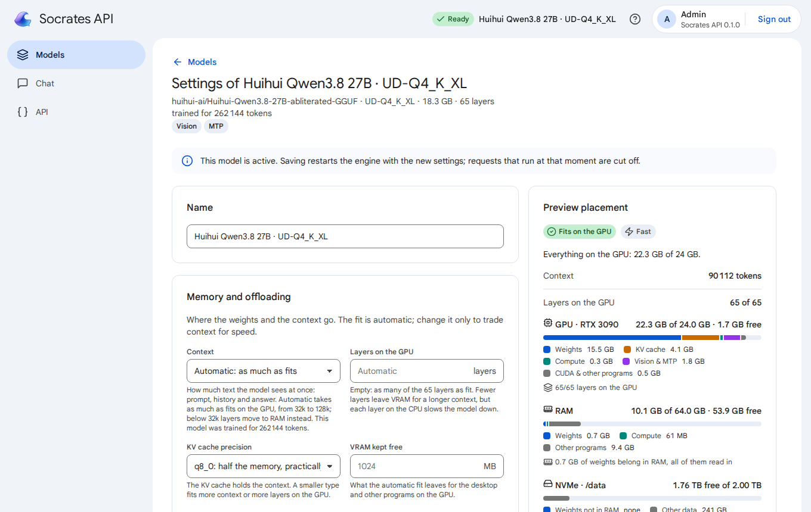
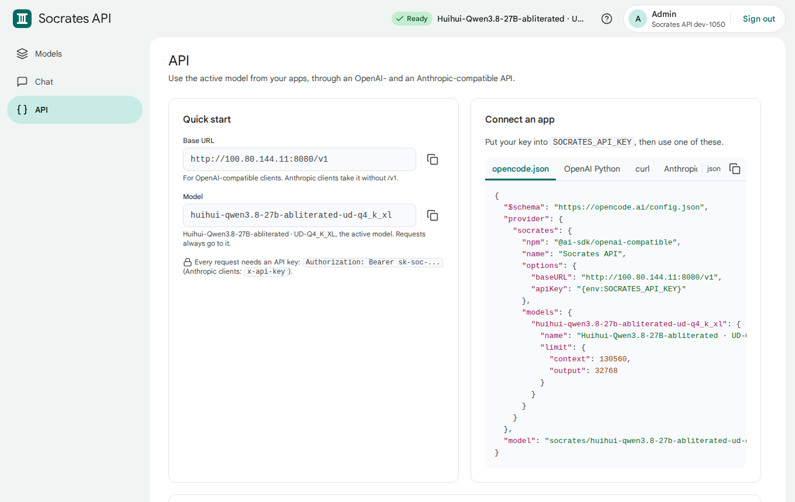
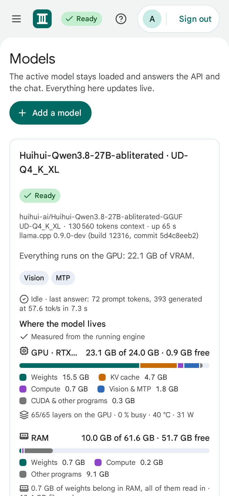
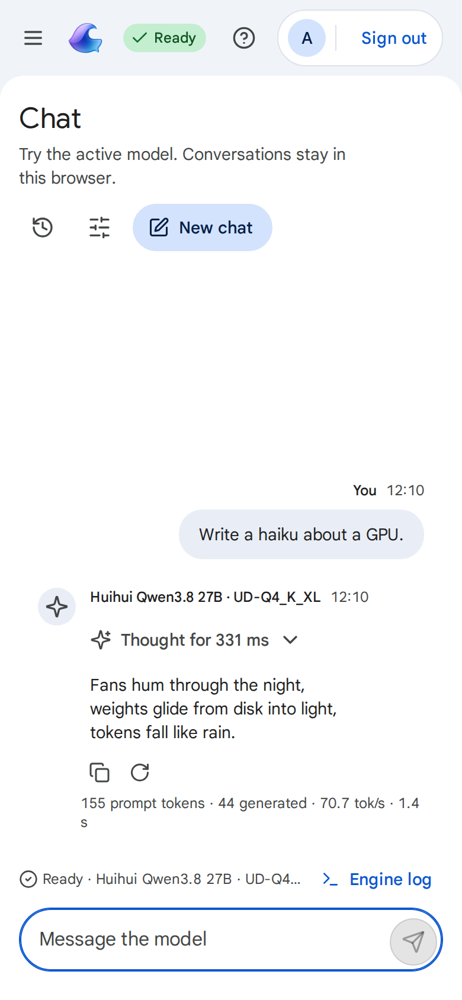
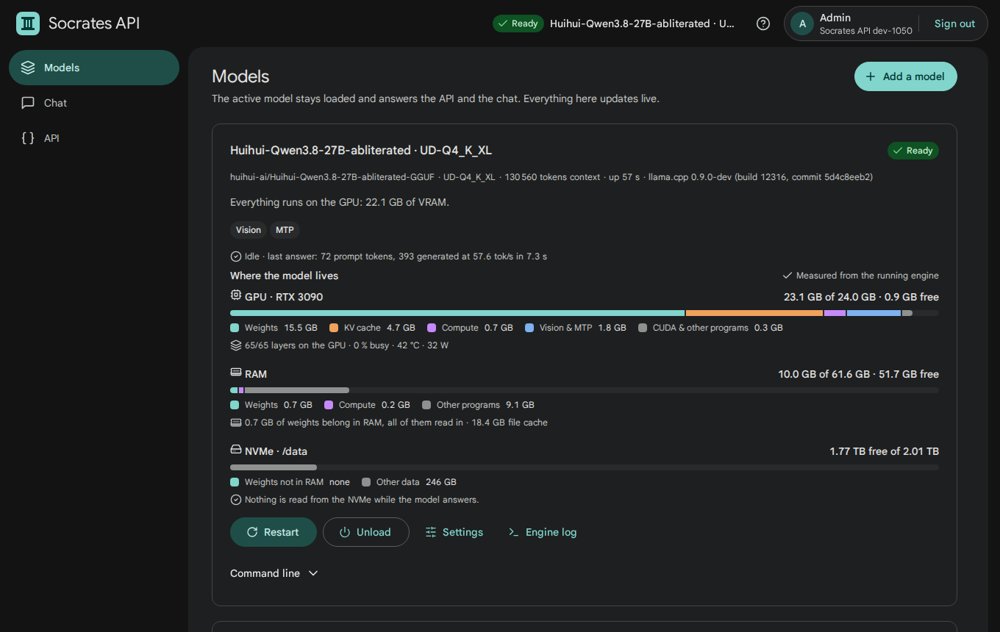
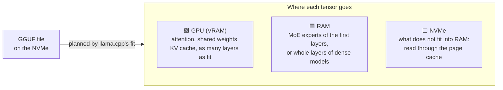

<div align="center">

# 🏛️ Socrates API

**Self-host LLMs on your own GPU, in one container.**<br>
Pick any model on Hugging Face, see exactly where it lives (GPU, RAM, NVMe) and use it through an OpenAI- and Anthropic-compatible API.


[](https://github.com/saschazesiger/SocratesApi/pkgs/container/socrates-api)
[](https://github.com/saschazesiger/SocratesApi/actions/workflows/ci.yml)

[⚡ Quick start](#-quick-start) ·
[👀 See it](#-see-it) ·
[🧠 Memory](#-gpu--ram--nvme) ·
[🔌 API](#-api) ·
[📚 Docs](#-documentation)



</div>

> **Status: first release, 0.1.0.** Tested end to end on an RTX 3090 (24 GB), 64 GB RAM and a 2 TB NVMe with
> Huihui Qwen3.8 27B, Qwen3.8-Flash-Next (78 GB MoE), a model converted from safetensors, the chat and opencode.
> Even DeepSeek V4.1 Flash (250 GB) runs, at ~5 tok/s from the NVMe (see [Memory](docs/memory.md#-measured-on-an-rtx-3090-64-gb-ram-nvme)).

## ✨ Why Socrates API?

| | |
|---|---|
| 🤗 **Any model from Hugging Face** | Search or paste `owner/name`. Every quantisation is listed with its size and whether it fits your machine; the best one is marked. |
| 🧮 **Placement planned by llama.cpp itself** | Before a model loads, llama.cpp's own fit decides what goes on the GPU and what stays in RAM, for exactly your GPU and context. Nothing is guessed. |
| 🧠 **GPU → RAM → NVMe** | Too large for the GPU? The experts of a MoE model move to RAM, layer by layer. Too large for RAM? The rest is read from the NVMe. You see every GB of it, live. |
| 🎚️ **Everything adjustable** | Context, layers on the GPU, MoE experts in RAM, KV cache precision, mmap / mlock / RAM, MTP, sampling, any llama.cpp flag. A preview shows the placement before you save. |
| 🔥 **Always loaded** | One model is active and stays in memory. It restarts by itself after a crash; requests wait while it loads instead of failing. |
| 💬 **Chat that shows what happens** | One status line: queued, reading the prompt (with tokens and tok/s), thinking, writing. Plus the engine log, one click away. |
| 🔌 **Standard API** | `/v1/chat/completions`, `/v1/completions`, `/v1/models`, `/v1/embeddings`, `/v1/messages` (Anthropic). Tools, streaming, reasoning. Works with opencode, the OpenAI and Anthropic SDKs. |
| 🔑 **API keys** | One key per app, revoke any time, usage per key, every request in a log. |
| 🛠️ **No GGUF? Convert it** | For repositories with only safetensors, Socrates downloads, converts and quantises them for you. |
| 📦 **One container** | One Go binary next to llama.cpp, all state in one volume. No database server, no Python unless you convert. |

## ⚡ Quick start

**1. Prepare the host** once: an NVIDIA driver and the [NVIDIA Container Toolkit](docs/quick-start.md#-1-prepare-the-host).

**2. Start Socrates API:**

```sh
docker run -d --name socrates --restart unless-stopped \
  -p 8080:8080 -v socrates:/data --device nvidia.com/gpu=all \
  ghcr.io/saschazesiger/socrates-api:latest
```

or with Compose, using the [docker-compose.yml](docker-compose.yml) of this repository: `docker compose up -d`.

**3. Open `http://<address of the machine>:8080` right away.** The first visitor sets the admin password, so do it
before anyone else can reach the port.

**4. Add a model.** *Models* → *Add a model* → search, pick the marked quantisation, *Download*. The first model
becomes active by itself.

| | Step | What you see |
|---|---|---|
| 1 | 🔐 Password | Choose the admin password (10+ characters). |
| 2 | 🤗 Add a model | Search Hugging Face, choose a quantisation: each shows *Fits on the GPU*, *GPU + RAM* or *Spills to NVMe*. |
| 3 | ⬇️ Download | Progress, speed and time left; resumes after a restart, checked with SHA-256. |
| 4 | 🚀 Ready | Planning → reading → loading → *Ready*, with the placement on GPU, RAM and NVMe. |
| 5 | 🔑 Use it | *API* → *Create a key*, copy the opencode or SDK snippet. |

The [quick start guide](docs/quick-start.md) walks through every click.

## 👀 See it

**Every step of loading, live.** Planning, reading from the NVMe (GB and GB/s), copying to the GPU, ready: here a
78 GB MoE model on a 24 GB GPU.


**Live placement.** Where the model lives right now, measured from the running engine: weights, KV cache and
compute buffers on the GPU, experts in RAM, and what is read from the NVMe.



<table>
<tr>
<td width="50%"><br>💬 <b>Chat</b>: thinking, answer and a live status line with tokens and tok/s.</td>
<td width="50%"><br>🤗 <b>Add a model</b>: every quantisation with its size and fit, the best one first.</td>
</tr>
<tr>
<td><br>🎚️ <b>Settings with preview</b>: change context or offloading and see the placement before loading.</td>
<td><br>🔌 <b>API</b>: base URL, snippets, keys and the request log.</td>
</tr>
</table>

📱 **Phones and dark mode included.**

<p>

&nbsp;&nbsp;

&nbsp;&nbsp;

</p>

<sub>The screenshots come from the mock server (`scripts/mock-server.mjs`): the interface as it is, with simulated figures.</sub>

## 🧠 GPU · RAM · NVMe



| Model on a 24 GB GPU + 64 GB RAM | Placement (automatic) | Measured |
|---|---|---|
| Huihui Qwen3.8 27B, UD-Q4_K_XL (17 GB) | all 65 layers on the GPU, 128k context, MTP | **~68 tok/s** writing, ~1 400 tok/s reading |
| DeepSeek V4.1 Flash Uncensored, GSQ-RCO IQ2_XXS (250 GB MoE) | 20 GB on the GPU, 44 GB in RAM, ~76 GB and the 110 GB Engram tables on the NVMe | **~5 tok/s** writing, ~55 tok/s reading |
| Huihui Qwen3.6 35B-A3B abliterated MTP, Q4_K (22 GB MoE) | all on the GPU, 44k context, vision, MTP | **~200 tok/s** writing, ~4 500 tok/s reading |
| Huihui Qwen3.8 Flash-Next abliterated v2, UD-IQ4_XS (94 GB MoE) | experts of 37 layers (43 GB) in RAM, 29 GB lookup table on the NVMe | **~22 tok/s** writing, ~430 tok/s reading |
| Qwen3.8-Flash-Next, UD-IQ3_XXS (78 GB MoE) | 48 layers on the GPU, experts of 31 layers (31 GB) in RAM, a 27 GB lookup table read from the NVMe | **~28 tok/s** writing |

Dense models go to the GPU first; the context shrinks before weights leave it, but never below 32k. A MoE model
keeps attention and the shared experts on the GPU and moves the routed experts of whole layers to RAM. Weights in
RAM are memory-mapped: what does not fit stays on the NVMe and is read when needed. More in
[Memory and offloading](docs/memory.md).

## 🔌 API

```sh
curl http://<host>:8080/v1/chat/completions \
  -H "Authorization: Bearer sk-soc-..." -H "Content-Type: application/json" \
  -d '{"model": "any", "messages": [{"role": "user", "content": "Hello!"}], "stream": true}'
```

| Endpoint | For |
|---|---|
| `POST /v1/chat/completions` | OpenAI chat: streaming, tools, reasoning (`reasoning_content`), images with a vision model |
| `POST /v1/completions` | OpenAI text completion |
| `GET /v1/models` | the active model |
| `POST /v1/embeddings` | embeddings (with an embedding model) |
| `POST /v1/messages` | Anthropic Messages: streaming, tools, thinking |
| `GET /health` | `200` when the model is ready, `503` otherwise |

Requests always go to the active model, whatever `model` says. While it loads they wait (up to 20 minutes) instead
of failing. Ready-made setups for opencode, the OpenAI SDK and Anthropic clients: [API](docs/api.md).

## 📋 Requirements

| | |
|---|---|
| 🖥️ **Host** | Linux x86_64 with Docker 25 or newer and the NVIDIA Container Toolkit. |
| 🎮 **GPU** | NVIDIA, driver 570 or newer (CUDA 12.8). Without a GPU, models run on the CPU, slowly. |
| 🧠 **RAM** | As much as the part of the model that does not fit on the GPU; less works with mmap, at the cost of speed. |
| 💾 **Disk** | Space for the models; an NVMe makes loading and spilling fast. |

## 🔒 Security

Socrates API is made for **your local network**. The interface is protected by the admin password, the API by API
keys (on by default). Do not publish port 8080 on the internet; put a reverse proxy with TLS in front if you must.
Details: [Security](docs/security.md).

## 📚 Documentation

| | |
|---|---|
| ⚡ [Quick start](docs/quick-start.md) | From an empty server to the first answer, click by click |
| 🤗 [Models](docs/models.md) | Finding, choosing a quantisation, downloading, converting, settings |
| 🧠 [Memory and offloading](docs/memory.md) | How the placement is planned, MoE, mmap / mlock / RAM, reading the bars |
| 🔌 [API](docs/api.md) | Endpoints, keys, opencode, OpenAI and Anthropic SDKs |
| 🔧 [Configuration](docs/configuration.md) | Environment variables, the data volume, updates, backup |
| 🔒 [Security](docs/security.md) | Password, keys, what to expose |
| 🩺 [Troubleshooting](docs/troubleshooting.md) | Symptoms, causes and fixes |
| 🛠️ [Development](docs/development.md) | Layout, build, tests, the mock server, screenshots |

## 🛠️ Develop

```sh
go build ./... && go vet ./... && go test ./...
node scripts/mock-server.mjs        # the interface on simulated data, http://localhost:8090
```

Rules for changes are in [AGENTS.md](AGENTS.md); everything else in [Development](docs/development.md).

## 📄 Licence and credits

MIT, see [LICENSE](LICENSE). Socrates API stands on:

- [llama.cpp](https://github.com/ggml-org/llama.cpp) for inference, the fit and the conversion (MIT, the official CUDA image is the base).
- [Z-Dash](https://github.com/saschazesiger/Z-Dash) for the whole interface (MIT, vendored).
- [Hugging Face Hub](https://huggingface.co) for models.
