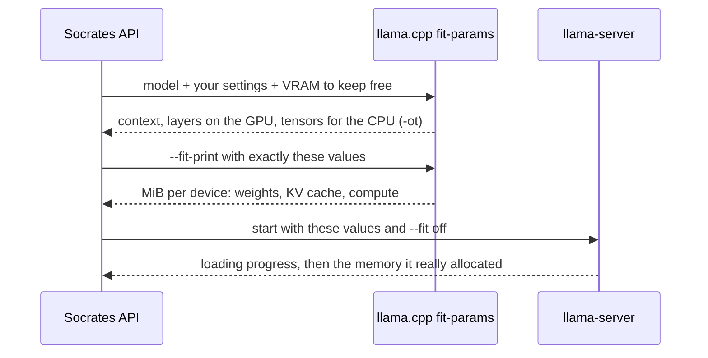
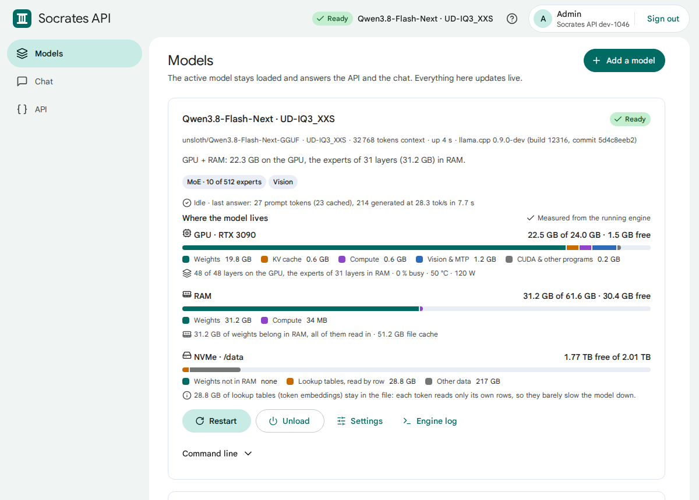

# 🧠 Memory and offloading

How Socrates API decides where a model lives, how to read the three bars, and what you can change.

## 🧭 How the placement is planned

1. **llama.cpp plans, not Socrates.** `llama fit-params` reads the GGUF header and computes every buffer for your
   GPU, without loading anything. Socrates then starts `llama-server` with exactly that result (`--fit off`), so
   what you were shown is what runs.
2. **Socrates knows every tensor.** It reads the GGUF header itself, applies llama.cpp's placement rules to each
   tensor and so knows which byte ranges of the file are used from RAM.
3. **Measured after the start.** Once ready, llama-server reports what it allocated per device, and Socrates checks
   every 2 seconds which RAM weights are really in memory (`mincore` on the file).

## 📐 The rules, in order

| | Dense model (e.g. Qwen3.8 27B) | MoE model (e.g. Qwen3.8-Flash-Next) |
|---|---|---|
| 1 | Everything on the GPU | Everything on the GPU |
| 2 | Automatic context shrinks, from 128k down to 32k | Automatic context shrinks, from 128k down to 32k |
| 3 | Whole layers move to RAM, the first ones first | The routed **experts** of whole layers move to RAM; attention, shared experts and the KV cache stay on the GPU |
| 4 | | If that is not enough, whole layers move |

Experts are the right thing to move: a token uses only a few of them (10 of 512 in Flash-Next), so the CPU computes
a small part, while everything every token needs stays on the GPU.

The token embeddings always stay in RAM (llama.cpp reads one row per token). Very large lookup tables, such as the
per-layer embeddings of Flash-Next (27 GB), are read row by row from the file and are shown separately: they barely
cost speed even when they stay on the NVMe.

## 📊 Reading the bars

| Bar | Segments |
|---|---|
| 🎮 **GPU** | weights · KV cache · compute buffers · vision projector & MTP · CUDA and other programs · free |
| 🧠 **RAM** | weights that are in RAM now · KV cache and compute (when layers run on the CPU) · other programs · free |
| 💾 **NVMe** | weights that belong in RAM but are not there (read from disk when needed: the slow part) · lookup tables · other data |

The line under each bar says it in words: *48 of 48 layers on the GPU, the experts of 31 layers in RAM*.
*Estimated* (preview) or *Measured from the running engine* is written above the bars.

## 🎚️ What you can change

*Models* → a model → **Settings**. **Preview placement** shows the result before you save; it takes about a second
and also works while another model runs (it plans against the VRAM that model would free).

| Setting | Default | When to change it |
|---|---|---|
| **Context** | Automatic (32k–128k) | Agents with long files want more; a fixed size frees VRAM for layers |
| **Layers on the GPU** | Automatic | Fewer layers leave VRAM for context, but each layer on the CPU costs speed |
| **MoE experts in RAM** | Automatic | Force more experts to RAM for a longer context |
| **KV cache precision** | `q8_0` | `f16` for the last bit of quality, `q4_0` for very long contexts |
| **VRAM kept free** | 1024 MB | More if the desktop or another program uses the GPU |
| **Weights outside the GPU** | mmap | see below |
| **Read the RAM weights in after start** | on | Fills free RAM so the first answers do not wait for the NVMe |
| **Parallel requests** | 1 | More users at once; they share the context |
| **Speculative decoding (MTP)** | on when the model has it | Off to save ~0.6 GB VRAM |

### mmap, mlock or RAM

| Mode | What it does | Use it when |
|---|---|---|
| **mmap** (default) | Weights are mapped from the file. The kernel keeps what fits in RAM and reads the rest from the NVMe. Other programs can take RAM back. | Almost always; the only mode for models larger than RAM |
| **mlock** | mmap, and the pages are pinned: never pushed out | The RAM part fits easily and must never be read from disk again. Needs `IPC_LOCK` (in the compose file) |
| **RAM** | Weights are copied into the process's memory | You want the model independent of the file cache; needs RAM for all CPU weights |

## 🔥 Keeping the model ready

- The active model stays loaded. After a crash it restarts after 5 s, 15 s, 45 s …; after 5 crashes in a row it stops
  and says why.
- After the start, Socrates drops the file cache of the weights that went to the GPU and of all other models, then
  reads the RAM weights in (never more than the free RAM, minus 4 GB).
- Requests that arrive while the model loads wait for it (up to 20 minutes) instead of failing.

## 🧪 Measured on an RTX 3090, 64 GB RAM, NVMe

| Model | File | Placement | Writing | Reading the prompt |
|---|---|---|---|---|
| Huihui Qwen3.8 27B UD-Q4_K_XL | 17.4 GB | all on the GPU, 128k context, MTP | ~68 tok/s | ~1 400 tok/s (34k prompt) |
| Qwen3.8-Flash-Next UD-IQ3_XXS | 77.9 GB | experts of 31 of 48 layers in RAM (31 GB), 27 GB lookup table on the NVMe | ~28 tok/s | ~26 tok/s (short prompts, CPU-bound) |
| Qwen3-0.6B, converted, Q4_K_M | 0.5 GB | all on the GPU | ~470 tok/s | |

> ⚠️ **DeepSeek-V4.1-Flash** (smallest GGUF 233 GB, ~120 GB needed in memory) does not fit a 24 GB + 64 GB
> machine in a usable way: it would read most of its weights from the NVMe for every token.
